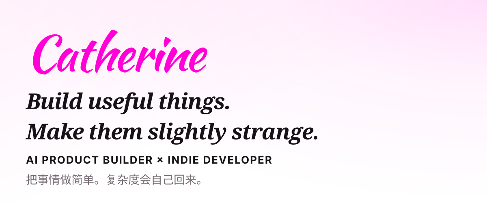

  

## 01 · About

Building AI products and developer tools. 
Turning ideas into small, useful systems. 

## 02 · Absurdity Skill

A little absurdity makes life more interesting. This skill turns ordinary content into something unexpectedly fun. 
抽象是一种态度，生活不能没有抽象。本 skill 负责量产这种态度。

[Explore Absurdity →](https://github.com/CatherineHasAGun/absurdity)

`Currently building` · `Python` · `AI/LLM`

### Tech

`Python` · `TypeScript` · `React` · `Next.js` · `AI/LLM`
